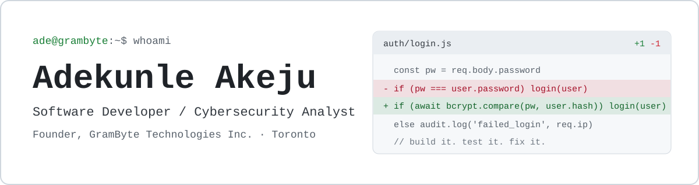

<picture>
  <source media="(prefers-color-scheme: dark)" srcset="assets/banner-dark.svg">
  <source media="(prefers-color-scheme: light)" srcset="assets/banner-light.svg">
  
</picture>

I build software and I work on keeping it secure. I'm based in Toronto and run [GramByte Technologies Inc.](https://grambyte.ca), where I help businesses with web development, cybersecurity, and cloud.

### What I work with

| | |
|---|---|
| **Web** | TypeScript, Next.js, Node.js, Express, three.js |
| **Backend and data** | Python, FastAPI, MongoDB |
| **Mobile** | Flutter, Dart, Kotlin |
| **Security** | Security assessments, vulnerability testing, monitoring, awareness training |
| **Application security** | JWT authentication, bcrypt password hashing, protected file handling |
| **Delivery** | Git, GitHub Actions, GitHub Pages, Google Workspace |

### Selected work

- **[grambyte.ca](https://grambyte.ca):** company site for GramByte Technologies, built with Next.js.
- **[thisradio.org](https://thisradio.org):** podcast site with a scroll-driven 3D radio, built with TypeScript and three.js.
- **[Gibbs Africa Peace Corps](https://gibbsafrica.co.za/):** cybersecurity consultation.

### Get in touch

[grambyte.ca](https://grambyte.ca) · [info@grambyte.ca](mailto:info@grambyte.ca)
